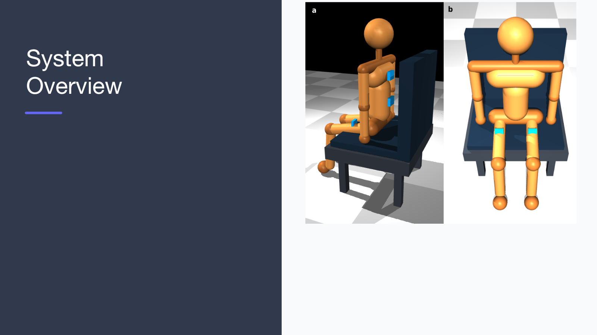
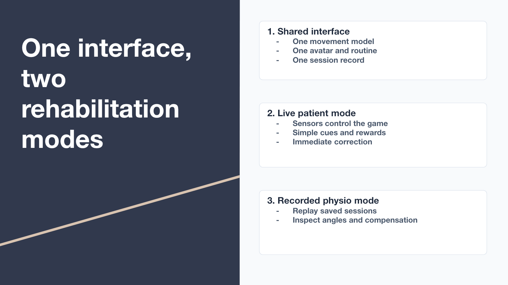

# ReDance — sensor-driven neurorehabilitation

ReDance turns seated trunk and leg rehabilitation exercises into a dance game.
Body-worn IMU sensors (or a MuJoCo avatar, for testing without hardware) feed a
real-time movement recognizer, which guides the patient through a choreographed
warmup + dance routine with videos, music and spoken German feedback. Each
session is recorded so a physiotherapist can replay it later with detailed
joint-angle traces.

Built for the *Neurorehabilitation Projektpraktikum* at TUM (summer 2026).





**Slides:** [final presentation (PDF)](docs/ReDance_Final_Presentation.pdf) ·
[editable .pptx](docs/ReDance_Final_Presentation.pptx) ·
[software section (.pptx)](docs/ReDance_Software_Section.pptx)

## Repository layout

| Path | What it is |
|---|---|
| `live_action.py`, `mapping.py`, `classify.py`, `game.py` | The app: recognition GUI, IMU → feature mapping, movement classifier, routine game |
| `run_professional_rehab.py`, `professional_rehab_avatar.xml` | MuJoCo avatar viewer and model |
| `Arduino/` | ESP32 firmware sketches for 1–5 ICM-20948 IMUs (the app uses `IMU_getAccGyr_twoAddr_oneMult_fourIMU`) |
| `imu_collect.py`, `datalogger/` | Recording tools and plotting scripts for raw IMU logs |
| `dataset/`, `logs/`, `datalogger/logs/` | Recorded sensor data from test sessions |
| `easy_videos/`, `sounds/`, `rehab_music.mp3` | Media played by the game (one short clip per movement, spoken German feedback, background music) |
| `instruction_video.mp4` | Full-length instruction video of the routine (the game now plays the clips in `easy_videos/` instead) |
| `patient_settings.txt` | Per-patient movement thresholds read by `classify.py` |
| `Dance_Sequence.xlsx` | The choreography the routine is based on |
| `system_flowchart.html` | Interactive flowchart of the whole system (open in a browser) |
| `docs/` | Final presentation and images |

## Components

| File | Role |
|---|---|
| `run_professional_rehab.py` | Optional standalone MuJoCo viewer: animates the avatar by keyboard and can mirror recognized movements (key `L`) |
| `live_action.py` | Main app: reads the sensors (or the keyboard simulator), classifies the current movement, shows the avatar, runs the routine game, logs each session, publishes results (`live_state.json`) |
| `classify.py` | Single-label action classifier (NEUTRAL, LEAN, LIFT_L, LIFT_R, TURN_LEFT, TURN_RIGHT) with gating and debounce |
| `mapping.py` | Turns raw IMU samples into normalized lean/lift/turn features (lean from the lumbar sensor, turn from the cervical sensor, lifts from the thighs) |
| `game.py` | Routine game: the warmup + dance choreography, step by step |
| `professional_rehab_avatar.xml` | MuJoCo model of the seated avatar (sides named in the avatar's own anatomical frame) |
| `imu_collect.py` | Dataset recorder: logs raw IMU streams to CSV with live plots |

---

## 1. Setup

### macOS

1. Open Terminal and clone the repository:

   ```bash
   git clone https://github.com/yujieyang0225-prog/ReDance.git
   cd ReDance
   ```

2. Create a virtual environment and install the dependencies
   (Python 3.10 or newer; check with `python3 --version`):

   ```bash
   python3 -m venv .venv
   source .venv/bin/activate
   pip install mujoco pyqtgraph PyQt6 numpy pyserial
   ```

### Windows

1. Install Python 3.10+ from https://www.python.org/downloads/ .
   During installation tick **"Add python.exe to PATH"**.

2. Open *PowerShell* (or *Command Prompt*) and clone the repository:

   ```powershell
   git clone https://github.com/yujieyang0225-prog/ReDance.git
   cd ReDance
   ```

   (If `git` is missing, install it from https://git-scm.com/download/win .)

3. Create a virtual environment and install the dependencies:

   ```powershell
   py -m venv .venv
   .venv\Scripts\activate
   pip install mujoco pyqtgraph PyQt6 numpy pyserial
   ```

   If PowerShell refuses to run the activate script, run once:
   `Set-ExecutionPolicy -Scope CurrentUser RemoteSigned`

---

## 2. Run without sensors (simulator)

```bash
python live_action.py --mode simulate
```

The game window opens (German UI). Click **Spiel Starten**, then play the
routine with the keyboard:

| Key | Move |
|---|---|
| `Q` | Neutral (rest) |
| `W` | Trunk bending (lean) |
| `E` | Left leg raise |
| `R` | Right leg raise |
| `T` | Trunk rotation left |
| `Y` | Trunk rotation right |

### Optional: standalone MuJoCo viewer

`run_professional_rehab.py` opens a separate 3D avatar that can mirror the
recognized movement. Start it in a second terminal (venv active), click its
window and press `L`:

```bash
# macOS — MUST use mjpython (installed with the mujoco package):
./.venv/bin/mjpython run_professional_rehab.py
```

```powershell
# Windows — plain python works:
python run_professional_rehab.py
```

Keys `1`–`5` animate the avatar by hand (rotate left/right, lean, left/right
leg raise; `0` resets). The camera faces the avatar, so the screen is a
mirror: all labels use the avatar's own anatomical left/right, the same frame
the body-worn sensors report.

---

## 3. Run with sensors (live mode)

### Hardware

- Adafruit Feather ESP32 V2 flashed with
  `Arduino/IMU_getAccGyr_twoAddr_oneMult_fourIMU` (board package v2.0.17,
  ICM20948_WE library v1.1.11, 115200 baud). In the Arduino IDE, add
  `https://dl.espressif.com/dl/package_esp32_index.json` under
  *File → Preferences → Additional boards manager URLs*, install **esp32**
  v2.0.17 in the Boards Manager, select **Adafruit Feather ESP32 V2**, and
  install **ICM20948_WE** by Wolfgang Ewald from the Library Manager.
- Four ICM-20948 IMUs: **IMU0 lumbar** (lower back), **IMU1 cervical**
  (neck), **IMU3 left thigh**, **IMU4 right thigh**. The thigh sensors
  connect through the I2C multiplexer.

### Find the serial port and configure it

- **macOS**: plug the board in and run `ls /dev/cu.*` — the board appears
  as something like `/dev/cu.usbserial-59690891081`.
- **Windows**: open *Device Manager → Ports (COM & LPT)* — the board
  appears as e.g. `Silicon Labs CP210x` on a port like `COM5`. If no port
  appears, install the CP210x VCP driver from Silicon Labs.

Open `live_action.py` and set the port at the top:

```python
SERIAL_PORT = "/dev/cu.usbserial-59690891081"   # macOS example
SERIAL_PORT = "COM5"                            # Windows example
```

### Start a session

1. Start recognition on the sensors:

   ```bash
   python live_action.py --mode live
   ```

   The window shows the avatar on the left (it mirrors your recognized
   movement), the game in the middle and the instruction video on the right.
2. Strap the sensors on, sit still in neutral, and click
   **Neu kalibrieren (bitte still sitzen)** — calibration takes 2 seconds and
   captures your personal neutral pose. Recalibrate any time a sensor is
   moved.
3. Click **Spiel Starten** to begin the routine.

---

## 4. The routine (game)

The recognition window guides you through the choreography and shows the
current step, its progress, and the next expected move. A wrong or
out-of-order move flashes a warning but does **not** reset your progress.

**Warmup**
1. Baseline — hold neutral for 10 s (timer restarts if you move)
2. Foot Rotate — 20 s instructed (not sensor-checked)
3. Reach-Over — 20 s instructed

**Dance** (every move is checked, in order)
1. Tip Toes — lift_L → lift_R, alternating ×3
2. Lift off R — lift_R ×3
3. Lift off L — lift_L ×3
4. Babysteps — lift_L ×3
5. + 6. Trunk Flex — lean ×2, twice
7. Trunk Rotate — turn LEFT then turn RIGHT
8.–11. the same block again (Tip Toes, Flex ×2 twice, Rotate)
12. Babysteps — lift_R ×3

Scoring: +10 per correct move, +20 per completed step, +100 for finishing
the routine — 760 points per round, then it loops. Edit `ROUTINE` at the
top of `game.py` to change the choreography.

---

## 5. How it works (data flow)

```
ESP32 (4 IMUs, serial)  --or--  keyboard simulator (--mode simulate)
            |                            |
            +---------> live_action.py <-+
                        mapping.py -> classify.py -> game.py
                              |
              avatar panel + game UI + session log (logs/game_sessions/)
                              |
                        live_state.json
                              |
            optional MuJoCo viewer (press L: avatar mirrors you)
```

Sensor data is converted to normalized features (`lean`, `lift_L`, `lift_R`,
and a signed `turn` that tracks the held angle) and passes through one
classifier, which picks a single dominant movement with debouncing.

---

## 6. Troubleshooting

| Symptom | Cause / fix |
|---|---|
| macOS: viewer crashes at start with a launch error | Use `mjpython`, not `python`, for `run_professional_rehab.py` |
| "Port … not found" at startup | Board not plugged / still enumerating — check the port name and retry; on Windows install the CP210x driver |
| Port keeps disappearing and reappearing | Unstable USB connection: reseat the cable or use another USB port |
| A lift bar stuck at 0 while the leg moves | That thigh IMU isn't delivering data (NaN or zeros) — check the multiplexer wiring; the app keeps running on the healthy sensors |
| Features large while sitting still | Sensors moved after calibration — click **Recalibrate (hold still)** |
| Turn left/right look mirrored on screen | The screen is a mirror view; labels are in YOUR body frame, not the observer's |
| "Video file not found" in the video panel | The game plays the short clips in `easy_videos/` — make sure that folder sits next to `live_action.py` |

---

## Team

ReDance was built by **Simon Appoltshauser, Emily Joyce, Eraraya Morenzo Muten,
Maysa Ouaja and Yujie Yang**.

This repository is maintained by Yujie Yang. It continues the team's original
repository,
[morenzoe/Neurorehabilitation_Projekpraktikum](https://github.com/morenzoe/Neurorehabilitation_Projekpraktikum),
with the full commit history kept, so every change still shows its original
author. Run `git shortlog -sn` to see who contributed what.

Branches:

- `main` — the complete project (the original `Combination` branch, with the
  original `main` merged in).
- `Simulation` — earlier keyboard-only simulation, kept for reference.

## License

MIT — see [LICENSE](LICENSE). The original copyright notice
(© 2026 Eraraya Morenzo Muten) is kept as the license requires.
